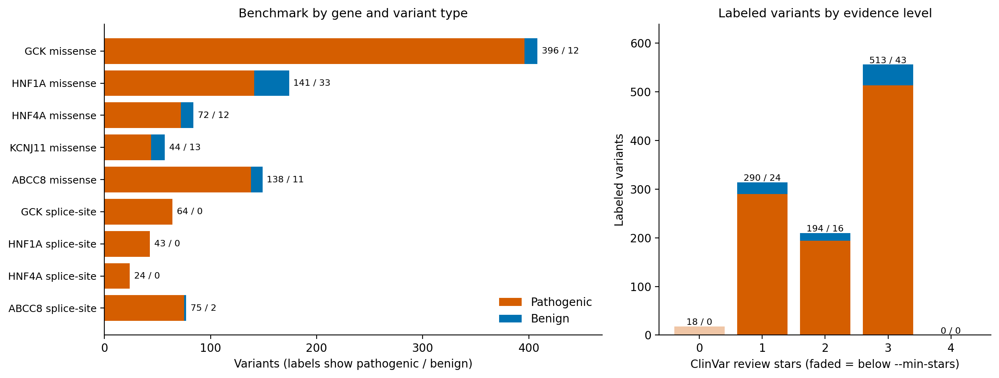

# Evaluating EVEE on diabetes-related genes

## Question

Can EVEE distinguish harmful (pathogenic) from harmless (benign) variants across genes involved in insulin production and blood-sugar control, and does its performance differ between **missense** and **splice-site** variants?

We focus on five genes:

| Gene   | Role                                               | Associated conditions                      |
| ------ | -------------------------------------------------- | ------------------------------------------ |
| GCK    | Glucose sensor in pancreatic beta cells            | GCK-MODY (a mild, stable form of diabetes) |
| HNF1A  | Transcription factor regulating beta-cell function | HNF1A-MODY                                 |
| HNF4A  | Transcription factor regulating beta-cell function | HNF4A-MODY                                 |
| KCNJ11 | Subunit of the beta-cell K-ATP channel (Kir6.2)    | Neonatal diabetes, hyperinsulinism         |
| ABCC8  | Subunit of the beta-cell K-ATP channel (SUR1)      | Neonatal diabetes, hyperinsulinism         |

EVEE is _[one-line description of EVEE and what it predicts]_.

## Why this matters

- **Variant interpretation affects treatment.** In monogenic diabetes the specific gene and variant often change management. For example, GCK-MODY usually needs no medication, HNF1A- and HNF4A-MODY typically respond well to sulfonylureas, and many people with K-ATP channel neonatal diabetes (KCNJ11, ABCC8) can switch from insulin to sulfonylureas. A correct pathogenic/benign call can therefore avoid misdiagnosis and unnecessary treatment.
- **Many variants remain unclassified.** In this dataset, 1,738 missense and splice-site variants are variants of uncertain significance (VUS), against 1,080 variants with a confident benign or pathogenic label. Reliable computational predictors could help prioritize VUS for follow-up.
- **Missense and splice-site variants act through different mechanisms.** Missense variants change a single amino acid. Canonical splice-site variants disrupt transcript processing, and their effect is not always visible at the protein level. Predictors may therefore perform differently on the two classes.
- **The genes cover different disease mechanisms.** GCK, HNF1A, and HNF4A cause diabetes through loss of function, while KCNJ11 and ABCC8 can cause either diabetes (gain of function) or hyperinsulinism (loss of function). This lets us check whether performance holds across genes and mechanisms.

## Project plan

1. **Build a labeled benchmark from ClinVar** (done; see below).
2. **Score every variant with EVEE**, including the VUS.
3. **Evaluate performance** overall, per gene, and stratified by variant type, ClinVar evidence level, protein domain, and conservation.
4. **Compare predictions for uncertain variants** with the pathogenic and benign groups.
5. **Build a disease-specific model that works across the whole gene set**, validated by leave-one-gene-out (train on four genes, test on the fifth) to check that it generalizes across the pathway.

## Dataset

Variants for GCK, HNF1A, HNF4A, KCNJ11, and ABCC8 were downloaded from ClinVar (download date: `YYYY-MM-DD`) and filtered with `prepare_evee_dataset.py`:

```bash
python3 prepare_evee_dataset.py raw/
```

### Filtering criteria

- **Genes:** GCK, HNF1A, HNF4A, KCNJ11, ABCC8. Variants listed under more than one gene are excluded.
- **Labels:** `Target = 1` for Pathogenic / Likely pathogenic, `Target = 0` for Benign / Likely benign. VUS and conflicting classifications are not in the benchmark but are kept in separate files for scoring and stratified analysis.
- **Review quality:** at least 1 ClinVar review star (single submitter or better) for the benchmark. Use `--min-stars N` to change this.
- **Variant type:** `missense` or canonical `splice-site` (splice donor/acceptor). Splice-region variants are not treated as splice-site, and records matching both types are excluded as ambiguous.
- **Duplicates:** removed by ClinVar `VariationID`.
- **Input handling:** extra trailing tabs in the ClinVar TSVs are stripped automatically.

### Results

7,374 ClinVar records were loaded and 21 duplicates removed, leaving 7,353 unique variants. **1,080 variants** passed all benchmark filters.



**Where the records went**

| Step                                                | Records   |
| --------------------------------------------------- | --------- |
| Records loaded (all files)                          | 7,374     |
| Duplicate records removed                           | 21        |
| **Unique variants**                                 | **7,353** |
| Excluded: multi-gene variant                        | 323       |
| Excluded: no clear benign/pathogenic classification | 3,055     |
| &nbsp;&nbsp;of which VUS                            | 2,162     |
| &nbsp;&nbsp;of which conflicting                    | 813       |
| &nbsp;&nbsp;of which other                          | 80        |
| Excluded: insufficient review stars                 | 72        |
| Excluded: not missense or canonical splice-site     | 2,817     |
| Excluded: ambiguous variant type                    | 6         |
| **Included in benchmark**                           | **1,080** |

Each record is counted under the first exclusion reason that applied. Details for every excluded record are in `evee_excluded.csv`.

**Benchmark by gene and variant type**

| Variant type    | Gene          | Pathogenic | Benign | Total     | % Pathogenic | AUROC / AUPRC meaningful? |
| --------------- | ------------- | ---------- | ------ | --------- | ------------ | ------------------------- |
| Missense        | GCK           | 396        | 12     | 408       | 97.1%        | Limited                   |
| Missense        | HNF1A         | 141        | 33     | 174       | 81.0%        | Yes                       |
| Missense        | HNF4A         | 72         | 12     | 84        | 85.7%        | Limited                   |
| Missense        | KCNJ11        | 44         | 13     | 57        | 77.2%        | Limited                   |
| Missense        | ABCC8         | 138        | 11     | 149       | 92.6%        | Limited                   |
| **Missense**    | **All genes** | **791**    | **81** | **872**   | **90.7%**    | **Yes**                   |
| Splice-site     | GCK           | 64         | 0      | 64        | 100.0%       | No                        |
| Splice-site     | HNF1A         | 43         | 0      | 43        | 100.0%       | No                        |
| Splice-site     | HNF4A         | 24         | 0      | 24        | 100.0%       | No                        |
| Splice-site     | ABCC8         | 75         | 2      | 77        | 97.4%        | No                        |
| **Splice-site** | **All genes** | **206**    | **2**  | **208**   | **99.0%**    | **No**                    |
| **All**         | **All genes** | **997**    | **83** | **1,080** | **92.3%**    | **Yes**                   |

"Yes" means at least 30 variants in the smaller class, "Limited" means at least 10, and "No" means fewer than 10. KCNJ11 has no canonical splice-site variants in the benchmark.

**Everything available for analysis** (all review levels, `evee_all_variants.csv`)

| Variant type | Pathogenic | Benign | VUS       | Conflicting | Other  | Total     |
| ------------ | ---------- | ------ | --------- | ----------- | ------ | --------- |
| Missense     | 805        | 81     | 1,716     | 295         | 57     | 2,954     |
| Splice-site  | 210        | 2      | 22        | 23          | 5      | 262       |
| **All**      | **1,015**  | **83** | **1,738** | **318**     | **62** | **3,216** |

ABCC8 contributes the most VUS (680 missense), followed by HNF1A (345) and GCK (280).

**Evidence level of labeled variants**

| ClinVar review level                        | Pathogenic | Benign | Total | In benchmark? |
| ------------------------------------------- | ---------- | ------ | ----- | ------------- |
| 0 stars (no criteria)                       | 18         | 0      | 18    | No            |
| 1 star (single submitter)                   | 290        | 24     | 314   | Yes           |
| 2 stars (multiple submitters, no conflicts) | 194        | 16     | 210   | Yes           |
| 3 stars (expert panel)                      | 513        | 43     | 556   | Yes           |
| 4 stars (practice guideline)                | 0          | 0      | 0     | Yes           |

### What the results mean for the analysis

- **The missense comparison is well supported.** With 791 pathogenic and 81 benign variants, pooled AUROC and AUPRC are meaningful. Per-gene estimates are less certain: only HNF1A has at least 30 benign missense variants, so report per-gene confidence intervals (bootstrap).
- **The splice-site comparison cannot measure discrimination.** Only 2 of 208 splice-site variants are benign, so specificity, AUROC, and AUPRC are not estimable. We can report how often EVEE flags the 206 pathogenic splice-site variants (sensitivity), but a fair "missense vs. splice-site" comparison needs benign splice controls from another source, such as common gnomAD variants near splice sites, which would be a different (near-splice) set and must be labeled as such.
- **The benchmark is heavily pathogenic** (92%). A model predicting "pathogenic" for everything would score 92% accuracy, so use AUPRC, MCC, balanced accuracy, or sensitivity/specificity with confidence intervals.
- **Half of the labels come from expert panels.** 556 of 1,080 benchmark variants (51%) have 3-star review. Expert classifications can themselves rely on computational predictors, so check whether EVEE's training data overlaps with ClinVar, and compare 3-star results against lower review levels.
- **Positions are ready for domain and conservation joins.** Protein position was parsed for 871 of 872 benchmark missense variants, and none carry a splice-region consequence, so no splice-region sensitivity analysis is needed.

### Limitations

- **Few benign variants.** There are 83 in total (81 missense), which limits per-gene analysis and any model trained on this data. Validate by holding out whole genes or protein regions, not random variants, because variants cluster within the same domains.
- **Disease mechanism differs by gene.** GCK, HNF1A, and HNF4A cause MODY, while ABCC8 and KCNJ11 cause both neonatal diabetes and hyperinsulinism. A pathogenic label therefore means different things across genes, so report per-gene results as well as pooled ones.
- **Label circularity.** ClinVar classifications may rely on in silico predictors or literature that overlaps with EVEE's training data.
- **Single-submitter evidence.** 314 benchmark variants rest on one star. Re-run with `--min-stars 2` as a sensitivity analysis.
- **VUS have no ground truth.** Their EVEE scores can be compared with the pathogenic and benign distributions, but they cannot be used to measure accuracy.

## Output files

Written to `data/` by default (change with `--outdir`).

| File                                     | Contents                                                                                                                       |
| ---------------------------------------- | ------------------------------------------------------------------------------------------------------------------------------ |
| `evee_dataset.csv`                       | Benchmark: labeled variants (`SNP`, `Gene`, `Variant_Type`, `Target`, plus metadata and coordinates)                           |
| `evee_missense.csv`                      | Benchmark, missense only                                                                                                       |
| `evee_splice_site.csv`                   | Benchmark, splice-site only                                                                                                    |
| `evee_all_variants.csv`                  | All single-gene missense and splice-site variants at every class and review level, with `Class_Group` and `In_Benchmark` flags |
| `evee_vus.csv`                           | Variants of uncertain significance, for scoring                                                                                |
| `evee_excluded.csv`                      | Records left out of the benchmark, with reasons                                                                                |
| `evee_summary.csv`                       | Benchmark counts by gene, variant type, and target                                                                             |
| `evee_overview.md` / `evee_overview.png` | Results overview and figure                                                                                                    |
