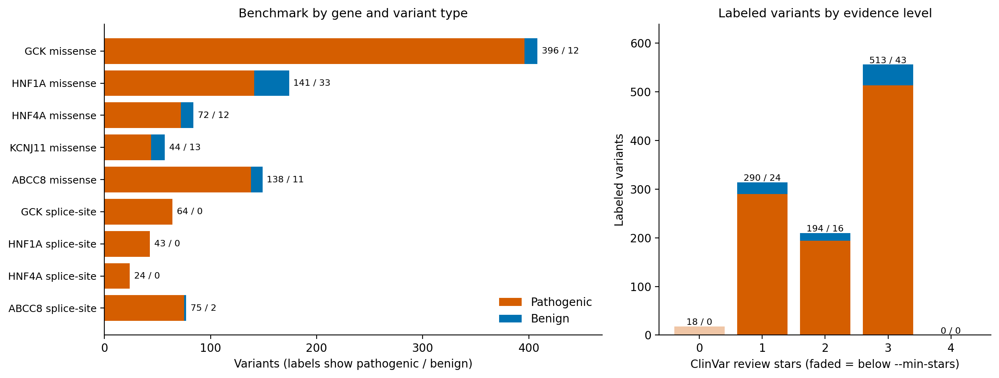

# EVEE benchmark overview

Genes: GCK, HNF1A, HNF4A, KCNJ11, ABCC8  |  minimum review stars: 1

## Headline

- **Benchmark:** 1,080 variants (997 pathogenic, 83 benign; 92.3% pathogenic)
- **Missense:** 872 variants (791 pathogenic, 81 benign; 90.7% pathogenic)
- **Splice-site:** 208 variants (206 pathogenic, 2 benign; 99.0% pathogenic)

## 1. Where the records went

| Step | Records |
|---|---|
| Records loaded (all files) | 7,374 |
| Not in target genes | 0 |
| Duplicate records removed | 21 |
| **Unique variants** | **7,353** |
| Excluded: Multi-gene variant | 323 |
| Excluded: Not a clear benign/pathogenic classification | 3,055 |
| ↳ of which VUS | 2,162 |
| ↳ of which Conflicting | 813 |
| ↳ of which Other | 80 |
| Excluded: Insufficient ClinVar review stars | 72 |
| Excluded: Not missense or canonical splice-site | 2,817 |
| Excluded: Ambiguous variant type | 6 |
| **Included in benchmark** | **1,080** |

## 2. Benchmark composition (labeled variants used for evaluation)

| Variant type | Gene | Pathogenic | Benign | Total | % Pathogenic | AUROC / AUPRC meaningful? |
|---|---|---|---|---|---|---|
| missense | GCK | 396 | 12 | 408 | 97.1% | Limited (wide CIs) |
| missense | HNF1A | 141 | 33 | 174 | 81.0% | Yes (>= 30 per class) |
| missense | HNF4A | 72 | 12 | 84 | 85.7% | Limited (wide CIs) |
| missense | KCNJ11 | 44 | 13 | 57 | 77.2% | Limited (wide CIs) |
| missense | ABCC8 | 138 | 11 | 149 | 92.6% | Limited (wide CIs) |
| missense | All genes | 791 | 81 | 872 | 90.7% | Yes (>= 30 per class) |
| splice-site | GCK | 64 | 0 | 64 | 100.0% | No (< 10 in a class) |
| splice-site | HNF1A | 43 | 0 | 43 | 100.0% | No (< 10 in a class) |
| splice-site | HNF4A | 24 | 0 | 24 | 100.0% | No (< 10 in a class) |
| splice-site | ABCC8 | 75 | 2 | 77 | 97.4% | No (< 10 in a class) |
| splice-site | All genes | 206 | 2 | 208 | 99.0% | No (< 10 in a class) |
| All | All genes | 997 | 83 | 1080 | 92.3% | Yes (>= 30 per class) |

Thresholds: 'Yes' needs at least 30 variants in the smaller class; 'Limited' needs at least 10.

## 3. Everything available for analysis (all review levels)

All single-gene missense and canonical splice-site variants, including uncertain (VUS) and conflicting variants (`evee_all_variants.csv`; VUS only in `evee_vus.csv`).

| Variant type | Gene | Pathogenic | Benign | VUS | Conflicting | Other | Total |
|---|---|---|---|---|---|---|---|
| missense | GCK | 399 | 12 | 280 | 79 | 24 | 794 |
| missense | HNF1A | 142 | 33 | 345 | 32 | 13 | 565 |
| missense | HNF4A | 75 | 12 | 213 | 20 | 6 | 326 |
| missense | KCNJ11 | 46 | 13 | 198 | 48 | 10 | 315 |
| missense | ABCC8 | 143 | 11 | 680 | 116 | 4 | 954 |
| missense | All genes | 805 | 81 | 1716 | 295 | 57 | 2954 |
| splice-site | GCK | 65 | 0 | 4 | 1 | 0 | 70 |
| splice-site | HNF1A | 45 | 0 | 1 | 0 | 2 | 48 |
| splice-site | HNF4A | 24 | 0 | 0 | 0 | 3 | 27 |
| splice-site | ABCC8 | 76 | 2 | 17 | 22 | 0 | 117 |
| splice-site | All genes | 210 | 2 | 22 | 23 | 5 | 262 |
| All | All genes | 1015 | 83 | 1738 | 318 | 62 | 3216 |

## 4. Evidence level of labeled variants

| Evidence tier | Pathogenic | Benign | Total | In benchmark? |
|---|---|---|---|---|
| 0 stars - no criteria / assertion only | 18 | 0 | 18 | No (below --min-stars) |
| 1 star - single submitter or conflicting | 290 | 24 | 314 | Yes |
| 2 stars - multiple submitters, no conflicts | 194 | 16 | 210 | Yes |
| 3 stars - expert panel | 513 | 43 | 556 | Yes |
| 4 stars - practice guideline | 0 | 0 | 0 | Yes |

## 5. Notes

- Only 2 benign splice-site variants in the benchmark: discrimination metrics (AUROC, AUPRC, specificity) are not meaningful for splice-site. Report sensitivity on pathogenic variants only, or add benign controls from another source.
- No splice-site variants for KCNJ11 in the benchmark.
- Fewer than 30 benign or pathogenic missense variants for GCK, HNF4A, KCNJ11, ABCC8: per-gene metrics will have wide confidence intervals, so pool genes and bootstrap.
- The benchmark is 92% pathogenic overall, so accuracy alone is misleading (predicting 'pathogenic' for everything would score 92%). Use AUPRC, MCC, balanced accuracy, or sensitivity/specificity with bootstrap confidence intervals.
- 1,738 single-gene missense/splice-site variants are VUS (`evee_vus.csv`). They have no ground truth, but their EVEE score distribution can be compared with the pathogenic and benign groups.
- Protein position was parsed for 871 of 872 benchmark missense variants (needed to join protein-domain and conservation annotations).
- 0 benchmark missense variants also carry a splice-region consequence (`Has_Splice_Region`); drop them for a sensitivity analysis if the number is non-trivial.
- Pathogenic labels mean different things across genes (GCK, HNF1A, HNF4A: MODY; KCNJ11, ABCC8: neonatal diabetes and hyperinsulinism), so report per-gene results alongside pooled ones.

